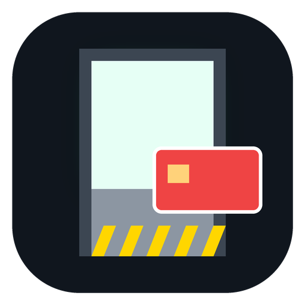

# Escape the Lab

Jogo 3D na primeira pessoa para Android. Acordas fechado num laboratório secreto depois de um acidente.
Exploras as salas, encontras cartões de acesso, resolves enigmas e tentas escapar. O tempo conta.



## Como se joga

- **Telemóvel:** arrasta no lado esquerdo do ecrã para andar, no lado direito para olhar; carrega em **USAR** quando a mira fica verde.
- **Computador:** WASD para andar, rato para olhar (clica para prender o rato), **E** para interagir.

O caminho (sem spoilers dos códigos, que mudam em cada partida):

1. **Quarentena:** lê o diário e encontra o cartão verde.
2. **Escritório:** o email no computador explica como funciona o cofre.
3. **Laboratório:** o quadro mostra a ordem das cores; cada frasco tem um número no rótulo. Há também uma nota da manutenção.
4. **Cofre:** o código abre-o e lá dentro está o cartão azul.
5. **Servidores:** liga os disjuntores certos para repor a energia e abre o cacifo eletrónico (cartão vermelho).
6. **Saída:** com energia e cartão vermelho, foge!

Os números dos frascos, a ordem das cores e os disjuntores certos são sorteados em cada partida.
O melhor tempo fica guardado.

## Instalar

O APK está em [`dist/EscapeTheLab-1.0.apk`](dist/EscapeTheLab-1.0.apk). Android 5.0 ou superior com WebGL.
Joga-se na horizontal.

## Originalidade (pronto a publicar)

- História, mapa, puzzles, código, texturas (desenhadas em canvas) e sons (sintetizados) criados de raiz.
- Único componente de terceiros: o motor 3D [three.js](https://threejs.org), licença MIT, que permite uso
  comercial. A licença vai incluída dentro do APK (`THREE-LICENSE.txt`), como a MIT exige.
- Sem permissões, sem Internet, sem anúncios, sem recolha de dados (ver [PRIVACY.md](PRIVACY.md)).
- Sem violência nem sangue: adequado para todas as idades (PEGI 3 / "Everyone").
- "Escape the Lab" é um título descritivo e já existem jogos com nomes parecidos. Antes de publicar,
  procura o nome na loja; se houver colisão, um subtítulo (ex.: "Escape the Lab: Protocolo LAB-7") resolve.

## Compilar

```bash
npm install && npm run build:web          # gera web/game.js (jogo + three.js)
sudo apt install aapt zipalign apksigner dalvik-exchange default-jdk
ANDROID_JAR=/caminho/android-34/android.jar ./build.sh
# para publicar, com a tua chave:
KEYSTORE=~/escapethelab.jks KS_ALIAS=escape KS_PASS='a-tua-password' ./build.sh
```

| Caminho | Conteúdo |
|---|---|
| `src/main.js` | Todo o jogo: mapa, salas, puzzles, controlos, física |
| `web/index.html` | Interface (menus, inventário, teclado do cofre) |
| `android/` | App Android (WebView em ecrã inteiro, horizontal) |
| `tools/make_icon.py` | Gera os ícones |

ID da app: `com.widgilabs.escapethelab`. As notas sobre Google Play (formato AAB) e a chave de assinatura
estão no [README da Órbita Lumi](../orbita-lumi/README.md#notas-para-a-publicação).
