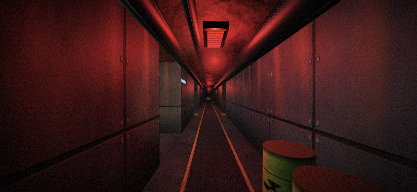

# Escape the Lab

Jogo 3D na primeira pessoa para Android. Acordas fechado num laboratório secreto depois de um acidente.
Exploras cinco setores, encontras cartões de acesso, resolves enigmas e tentas escapar.


## Como se joga

- **Telemóvel:** arrasta no lado esquerdo do ecrã para andar, no lado direito para olhar; carrega em **USAR** quando a mira fica verde. O botão **UV** aparece quando tens a lâmpada ultravioleta.
- **Computador:** WASD para andar, rato para olhar (clica para prender o rato), **E** para interagir, **U** para a luz UV.

## Capítulo 1 — Protocolo Ómega

Acordas sem memória como "Sujeito 12" numa instalação subterrânea selada. Alguém espalhou pelos setores um
código de desativação do núcleo Ómega, um dígito em cada setor. O capítulo tem cinco setores, pensados para
cerca de **25 minutos** na primeira vez (depende de quanto exploras e lês):

| Setor | Puzzles principais |
|---|---|
| **A — Quarentena** | Cartão verde; código do cofre (cores do quadro + números dos frascos); disjuntores; cacifo eletrónico |
| **B — Arquivo** | Lógica com fichas de pessoal (turnos + suspensões) para autorizar o elevador; válvulas de pressão para abrir a criogenia; fusível |
| **C — Genética** | Painel de memória de cores (3 rondas); lâmpada UV que revela um código escrito com tinta invisível; cofre de amostras |
| **D — Manutenção** | Labirinto escuro gerado em cada partida; manípulo da válvula; circuito de tubos para restabelecer a refrigeração |
| **E — Núcleo** | Barras de controlo por ordem; código Ómega com os 4 fragmentos; evacuação contra o relógio |

O capítulo **não termina com a fuga**: a história fica em aberto para o Capítulo 2.
O progresso é gravado no início de cada setor (botão **CONTINUAR** no menu). Os códigos, o puzzle de lógica,
as válvulas e o labirinto mudam em cada partida.

## Visual

Ambiente industrial escuro: betão gasto com fissuras, painéis de metal com rebites e ferrugem, teto
enferrujado, tubos, tanques com líquido luminoso, barris e caixotes com símbolo de radiação, passadeira
com faixas de perigo, luzes de emergência vermelhas e lanterna. Todas as texturas são geradas por código
(ruído fBm + mapas de relevo). Por cima há um efeito de câmara: tone mapping, vinheta, grão e aberração
cromática.

No menu, **GRÁFICOS: ALTA / LEVE** permite desligar o pós-processamento e baixar a resolução em
telemóveis mais fracos.



## Som

Todo o som é sintetizado em tempo real (Web Audio), sem ficheiros de som de terceiros. Ouve-se melhor com auscultadores.

- **Som 3D:** cada fonte tem posição; ouves de que lado vem e o volume cai com a distância.
- **Reverberação** de espaço de betão e **oclusão:** sons de outra sala ouvem-se abafados através das paredes.
- **Ambiente:** zumbido grave do edifício, ventilação, lâmpadas fluorescentes, servidores (mais fortes quando
  a energia volta), bombas e bolhas dos tanques, alarme de emergência no corredor até repores a energia, e
  sons aleatórios (gotas, metal a ranger, pancadas distantes).
- **Ações:** passos, portas hidráulicas, leitor de cartões, recusa, apanhar cartões, papel, teclado do cofre
  com tons DTMF, abertura do cofre, disjuntores, arranque da energia, cacifo e a saída para o exterior.
- **SOM: LIGADO / DESLIGADO** no menu e na pausa; o som para quando o jogo está em pausa ou em segundo plano.

Uma amostra gravada de uma partida está em [`dist/som-demo.m4a`](dist/som-demo.m4a).

## Instalar

O APK está em [`dist/EscapeTheLab-2.0.apk`](dist/EscapeTheLab-2.0.apk). Android 5.0 ou superior com WebGL.
Joga-se na horizontal.

## Originalidade (pronto a publicar)

- História, mapa, puzzles, código, texturas (geradas por código) e sons (sintetizados) criados de raiz.
  Nenhuma imagem foi copiada de outros jogos ou de referências.
- Único componente de terceiros: o motor 3D [three.js](https://threejs.org), licença MIT, que permite uso
  comercial. A licença vai incluída dentro do APK (`THREE-LICENSE.txt`), como a MIT exige.
- Sem permissões, sem Internet, sem anúncios, sem recolha de dados (ver [PRIVACY.md](PRIVACY.md)).
- Sem violência nem sangue: adequado para todas as idades (PEGI 3 / "Everyone").
- "Escape the Lab" é um título descritivo e já existem jogos com nomes parecidos. Antes de publicar,
  procura o nome na loja; se houver colisão, um subtítulo (ex.: "Escape the Lab: Protocolo LAB-7") resolve.

## Compilar

```bash
npm install && npm run build:web          # gera web/game.js (jogo + three.js)
sudo apt install aapt zipalign apksigner dalvik-exchange default-jdk
ANDROID_JAR=/caminho/android-34/android.jar ./build.sh
# para publicar, com a tua chave:
KEYSTORE=~/escapethelab.jks KS_ALIAS=escape KS_PASS='a-tua-password' ./build.sh
```

| Caminho | Conteúdo |
|---|---|
| `src/main.js` | Motor: gráficos, controlos, física, interface, puzzles genéricos, fluxo do capítulo |
| `src/sectors.js` | Os cinco setores do Capítulo 1 (mapas, puzzles, história) |
| `src/audio.js` | Motor de som sintetizado (3D, reverberação, ambiente, efeitos) |
| `web/index.html` | Interface (menus, inventário, teclado do cofre) |
| `android/` | App Android (WebView em ecrã inteiro, horizontal) |
| `tools/make_icon.py` | Gera os ícones |

ID da app: `com.widgilabs.escapethelab`. As notas sobre Google Play (formato AAB) e a chave de assinatura
estão no [README da Órbita Lumi](../orbita-lumi/README.md#notas-para-a-publicação).
